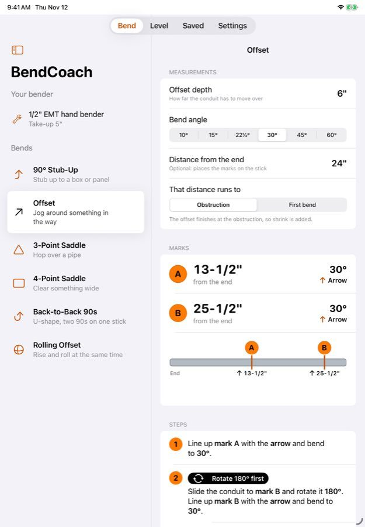

# BendCoach

A conduit-bending coach for iPhone and iPad. Enter a measurement and BendCoach shows numbered marks on
a drawing of the stick, which bender mark each one lines up with, and when to rotate the pipe.
Then it walks you through each bend with the phone as a digital level that buzzes and beeps
when you hit the angle.

**Status:** early MVP (v0.1.0). It builds and its math tests pass in CI, but it hasn't been
field-tested or released yet.


On iPad the Bend and Saved tabs become two columns:



## Features

| | Free | Pro (one-time) |
|---|---|---|
| 90° stub-ups and offsets | ✓ | ✓ |
| 3-point and 4-point saddles, back-to-back 90s, rolling offsets | | ✓ |
| Numbered marks on a drawing of the stick, plus a finished-shape preview | ✓ | ✓ |
| Guided bend mode with the built-in level | ✓ | ✓ |
| Tape-style keypad (feet, inches, 8ths and 16ths) | ✓ | ✓ |
| Bender presets and take-up calibration from one test bend | 1 custom bender | Unlimited |
| Saved bends, shareable as text | 5 | Unlimited |

## Open and run

You need a Mac with **Xcode 16 or later**. The app targets **iOS 17+**.

1. Open `BendCoach.xcodeproj`.
2. Select the **BendCoach** target, go to **Signing & Capabilities** and choose your team.
   If `com.astitvaswaroop.bendcoach` is taken, change the bundle ID.
3. Run it on a simulator or an iPhone. The level only works on a real iPhone because it needs
   the motion sensor.
4. Purchases run against `BendCoach.storekit`, which the scheme loads automatically. In Debug
   builds you can also skip the purchase: tap **Unlock Pro for testing** on the paywall, or turn
   on **Settings → BendCoach Pro → Unlock Pro for testing**. Release builds don't have either.

## Tests

```sh
swift test --package-path Packages/BendKit   # 39 unit tests for the bending math (runs on Linux too)
python3 tools/crosscheck.py                  # checks the formulas against Ideal, Greenlee and Klein examples
```

GitHub Actions runs both on every push and builds the app for the iOS Simulator on macOS.

### Screenshots in CI

Put `[screenshots]` in a commit message and CI runs the app in the simulator and screenshots
every screen on iPhone (light mode, dark mode and accessibility text sizes) and on iPad. The
screenshots are attached to the run as an artifact. This is a starting point for App Store
screenshots. It works through a debug-only launch argument that opens a screen with sample
numbers filled in. You can use it from Xcode too: add it under **Edit Scheme → Run → Arguments**.

```
-demoScreen offset              # calculator with sample inputs
-demoScreen offset:results      # same, with the marks listed first
-demoScreen guided              # guided bend mode
-demoScreen keypad              # the tape-measure keypad
-demoScreen level | saved | settings | benders | paywall
```

## Project layout

```
BendCoach/                 SwiftUI app (Xcode 16 synchronized folder: new files are picked up automatically)
  App/                     App entry point and tab root
  Model/                   SwiftData models: saved bends, custom benders
  Store/                   StoreKit 2 Pro unlock
  Support/                 Settings keys, environment values, display helpers
  Views/                   Calculators, keypad, drawings, level, benders, history, settings, paywall
Packages/BendKit/          Pure-Swift math library (no UIKit), with its own tests
BendCoach.storekit         Local StoreKit test config (Pro = non-consumable, $7.99 placeholder)
tools/                     Python cross-check of the math and the icon generator
docs/                      MATH.md (formulas + sources), RESEARCH.md (market), PRODUCT.md (plan)
```

## Releasing to the App Store

[`docs/APP_STORE.md`](docs/APP_STORE.md) is the step-by-step checklist: developer account, app
record, API key secrets, then the listing text to paste. The pieces in this repo:

- **Release workflow** (`.github/workflows/release.yml`, run it from the Actions tab) archives a
  Release build, signs it with the App Store Connect API key and uploads it to TestFlight.
- **App Store screenshots** (`.github/workflows/appstore-screenshots.yml`, or `[appstore]` in a
  commit message) publishes 6.9" iPhone, 13" iPad and in-app purchase screenshots on the
  `appstore-assets` release.
- [`PRIVACY.md`](PRIVACY.md) and [`SUPPORT.md`](SUPPORT.md) are the privacy policy and support
  pages the listing links to. `BendCoach/PrivacyInfo.xcprivacy` is the privacy manifest.

Before submitting, have an electrician test every bend type on scrap and compare the results
with `docs/MATH.md`. See `docs/PRODUCT.md` for the launch plan.
