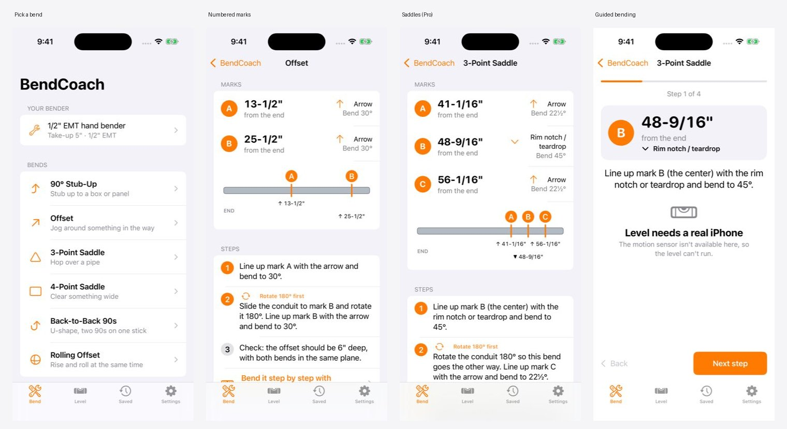

# BendCoach

A conduit-bending coach for iPhone. Enter a measurement and BendCoach shows numbered marks on
a drawing of the stick, which bender mark each one lines up with, and when to rotate the pipe.
Then it walks you through each bend with the phone as a digital level that buzzes and beeps
when you hit the angle.

**Status:** early MVP (v0.1.0). It builds and its math tests pass in CI, but it hasn't been
field-tested or released yet.



## Features

| | Free | Pro (one-time) |
|---|---|---|
| 90° stub-ups and offsets | ✓ | ✓ |
| 3-point and 4-point saddles, back-to-back 90s, rolling offsets | | ✓ |
| Numbered marks on a drawing of the stick, plus a finished-shape preview | ✓ | ✓ |
| Guided bend mode with the built-in level | ✓ | ✓ |
| Tape-style keypad (feet, inches, 8ths and 16ths) | ✓ | ✓ |
| Bender presets and take-up calibration from one test bend | 1 custom bender | Unlimited |
| Saved bends, shareable as text | 5 | Unlimited |

## Open and run

You need a Mac with **Xcode 16 or later**. The app targets **iOS 17+**.

1. Open `BendCoach.xcodeproj`.
2. Select the **BendCoach** target, go to **Signing & Capabilities** and choose your team.
   If `com.astitvaswaroop.bendcoach` is taken, change the bundle ID.
3. Run it on a simulator or an iPhone. The level only works on a real iPhone because it needs
   the motion sensor.
4. Purchases run against `BendCoach.storekit`, which the scheme loads automatically. In Debug
   builds you can also use **Settings → Developer → Unlock Pro** to skip the purchase.

## Tests

```sh
swift test --package-path Packages/BendKit   # 39 unit tests for the bending math (runs on Linux too)
python3 tools/crosscheck.py                  # checks the formulas against Ideal, Greenlee and Klein examples
```

GitHub Actions runs both on every push and builds the app for the iOS Simulator on macOS.

### Screenshots in CI

Put `[screenshots]` in a commit message and CI runs the app in the simulator, screenshots every
screen, and attaches them to the run as an artifact. This is a starting point for App Store
screenshots. It works through a debug-only launch argument that opens a screen with sample
numbers filled in. You can use it from Xcode too: add it under **Edit Scheme → Run → Arguments**.

```
-demoScreen offset              # calculator with sample inputs
-demoScreen offset:results      # same, with the marks listed first
-demoScreen guided              # guided bend mode
-demoScreen level | saved | settings | benders | paywall
```

## Project layout

```
BendCoach/                 SwiftUI app (Xcode 16 synchronized folder: new files are picked up automatically)
  App/                     App entry point and tab root
  Model/                   SwiftData models: saved bends, custom benders
  Store/                   StoreKit 2 Pro unlock
  Support/                 Settings keys, environment values, display helpers
  Views/                   Calculators, keypad, drawings, level, benders, history, settings, paywall
Packages/BendKit/          Pure-Swift math library (no UIKit), with its own tests
BendCoach.storekit         Local StoreKit test config (Pro = non-consumable, $7.99 placeholder)
tools/                     Python cross-check of the math and the icon generator
docs/                      MATH.md (formulas + sources), RESEARCH.md (market), PRODUCT.md (plan)
```

## Before the App Store

- Join the Apple Developer Program ($99/year). Create the app in App Store Connect, along with a
  non-consumable in-app purchase with the ID `com.astitvaswaroop.bendcoach.pro`.
- Have an electrician test every bend type on scrap and compare the results with `docs/MATH.md`.
- Replace the placeholder icon (`tools/make_icon.py`). Then take screenshots and publish a privacy
  policy URL. The app collects no data, so the policy can be short.
- See `docs/PRODUCT.md` for the launch plan.
